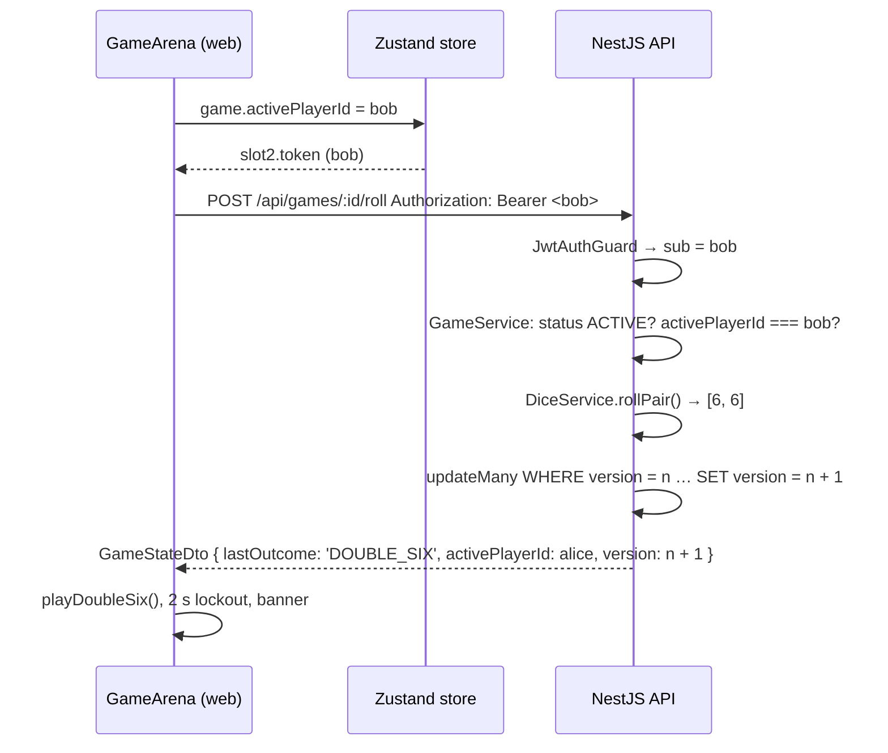

# Dice Arena

A two-player push-your-luck dice game. Two people sign in on the same screen (or one person plays the built-in AI), take turns rolling two dice to build a round score, and bank it with **Hold** before a **6 & 6** wipes the round and hands the dice over. First to the target score wins.

The project is a pnpm + Turborepo monorepo with three workspaces:

| Workspace | Package | Stack | Role |
| --- | --- | --- | --- |
| `apps/api` | `@dice-arena/api` | NestJS 12, Prisma 7 (SQLite), Zod, argon2, JWT | Owns every rule: dice RNG, turn validation, scoring, win detection, the AI opponent, auth, and persistence. |
| `apps/web` | `@dice-arena/web` | React 19, Vite, Tailwind 4, Zustand, Web Audio | Pure presentation and audio. Renders whatever `GameStateDto` the API returns; never computes game state. |
| `packages/shared` | `@dice-arena/shared` | Zod | Single source of truth for request/response schemas, DTO types, and constants used by both sides. |

## Table of contents

- [Quick Start](#quick-start)
- [Repository layout](#repository-layout)
- [Scripts](#scripts)
- [Game rules](#game-rules)
- [Assumptions](#assumptions)
- [What I'd do differently with more time](#what-id-do-differently-with-more-time)
- [API reference](#api-reference)
- [Architecture Decision Records](#architecture-decision-records)
- [Security checklist](#security-checklist)
- [Audio](#audio)
- [Configuration](#configuration)
- [Testing](#testing)

## Quick Start

Prerequisites: **Node.js ≥ 22.18** and **pnpm 12** (`corepack enable` picks up the version pinned in `package.json`).

```bash
pnpm install && pnpm db:push && pnpm dev
```

| Step | What it does |
| --- | --- |
| `pnpm install` | Installs every workspace. Native modules (`argon2`, `better-sqlite3`, Prisma engines) are allow-listed in `pnpm-workspace.yaml`, so no `--unsafe-perm` prompts. |
| `pnpm db:push` | Applies all Prisma migrations to the local SQLite file (`apps/api/prisma/dev.db` by default) and generates the Prisma client into `apps/api/src/generated/prisma`. Safe to re-run at any time. |
| `pnpm dev` | Starts everything through Turborepo: the shared package in watch mode, the API on <http://localhost:3000>, and the web app on <http://localhost:5173>. The API re-applies pending migrations and upserts the AI account (`RoboRoller`) on boot. |

Then open <http://localhost:5173>. Interactive API docs (Swagger UI) are at <http://localhost:3000/api/docs> outside production.

Nothing needs configuring for development: the API falls back to a development-only JWT secret, a local SQLite file, and a CORS whitelist of `http://localhost:5173`. See [Configuration](#configuration) for production.

### Playing a match

1. **Player 1** registers or logs in on the left card.
2. **Player 2** either registers/logs in on the right card or hands the seat to the AI.
3. Pick a target score (10–1000, default 100) and start the match.
4. Roll to add both dice to your round score. Hold to bank it and pass the turn. Roll **6 & 6** and the round is gone, the turn passes, and a two-second penalty lockout plays.
5. The leaderboard in the top bar ranks human players by wins (ties go to fewer games played).

## Repository layout

```
.
├── apps
│   ├── api                      NestJS API
│   │   ├── prisma               schema.prisma, migrations, dev.db (git-ignored)
│   │   ├── src
│   │   │   ├── auth             register/login, argon2 hashing, JwtAuthGuard, @CurrentUser()
│   │   │   ├── common           Zod validation pipe/decorators, throttling presets
│   │   │   ├── config           Zod-validated environment, path helpers
│   │   │   ├── game             GameService (all rules), DiceService (RNG), AiStrategyService
│   │   │   ├── health           GET /api/health
│   │   │   ├── prisma           PrismaService (better-sqlite3 driver adapter)
│   │   │   └── users            leaderboard, AI account bootstrap
│   │   └── test                 supertest e2e specs against a throwaway SQLite database
│   └── web                      React client
│       └── src
│           ├── api              typed fetch client; validates every response against the shared schemas
│           ├── audio            soundEngine.ts (Web Audio synthesis) + useAudioSettings hook
│           ├── components       lobby (dual auth), game (arena), leaderboard, audio controls, ui primitives
│           ├── store            Zustand store: two auth slots, current game, action lock
│           └── test             fixtures, fetch mock, fake AudioContext
├── packages
│   └── shared                   Zod schemas, DTO types, constants (no runtime side effects)
├── turbo.json                   task graph: build/typecheck/test depend on ^build and db:generate
└── pnpm-workspace.yaml          workspaces, dependency catalog, native build allow-list
```

## Scripts

Run from the repository root unless noted.

| Command | Description |
| --- | --- |
| `pnpm dev` | Shared package in watch mode, API with `nest start --watch`, web with Vite HMR. |
| `pnpm build` | Builds all three workspaces (`tsup`, `nest build`, `vite build`). |
| `pnpm typecheck` | `tsc --noEmit` in every workspace with `strict`, `noUncheckedIndexedAccess`, `noUnusedLocals`, etc. |
| `pnpm test` | Vitest everywhere: shared schema tests, API unit + e2e, web component tests. |
| `pnpm db:push` | Apply migrations and regenerate the Prisma client (see Quick Start). |
| `pnpm --filter @dice-arena/api db:migrate` | Create a new migration after editing `schema.prisma`. |
| `pnpm --filter @dice-arena/api db:studio` | Browse the SQLite database in Prisma Studio. |

## Game rules

All rules are enforced in `apps/api/src/game/game.service.ts`. The client never evaluates them.

| Action | Server behaviour | `lastOutcome` |
| --- | --- | --- |
| **Roll** | Draws two dice with `crypto.randomInt(1, 7)`. If both are 6, `roundScore` becomes 0 and `activePlayerId` switches to the opponent. Otherwise `roundScore += d1 + d2` and the turn continues. | `DOUBLE_SIX` / `STANDARD` |
| **Hold** | Rejected with `400` when `roundScore === 0`. Otherwise the round is added to the active player's global score and reset to 0. If the new global score `>= targetScore`, the game becomes `FINISHED`, `winnerId` is set, and `wins`/`gamesPlayed` are incremented atomically on both `User` rows. Otherwise the turn passes. | `WIN` / `HOLD` |
| **AI step** | Plays exactly one roll or hold for the AI so the client can show its turn one step at a time. The AI holds at a round total of 21, or 32 when the opponent is within 18 points of the target, and always holds when it can win. | as above |
| **Reset** | Creates a fresh game between the same two players, keeping the previous target unless a new one is sent. | `null` |

Every mutation first checks `status === 'ACTIVE'` (else `409`) and `activePlayerId === <JWT sub>` (else `403 Not your turn`).

## Assumptions

A few rules and product choices are left open by the prompt. This is how they are interpreted here.

### Same-page dual-slot JWT auth

Both players sit at one browser. A cookie names a single identity per origin, so it cannot tell the API which of the two people pressed Roll. Each seat stores its own access token (`slot1` and `slot2` in the Zustand store). Roll and hold send the Bearer token of the slot whose user id equals `activePlayerId`. The server still checks that the JWT subject is the active player. The tradeoff is written out in [ADR-003](#adr-003-same-page-dual-auth-with-per-slot-bearer-tokens).

### 6 & 6 scoring

Only a roll of 6 and 6 ends the round: `roundScore` is set to 0, the turn passes, and the two-second lockout plays. Points already banked on `globalScore` stay where they are. Any other pair, including a lone 6, adds both faces to the round and the same player rolls again.

### Zero-point holds and `canWinOnHold`

Hold is rejected with `400` when `roundScore === 0` — the start of a turn, and the state right after a 6 & 6. The client disables the Hold button in that case; the API is what makes the action illegal.

When the active player's banked score plus the current round would reach `targetScore`, and the game is still `ACTIVE`, the API sets `canWinOnHold: true` on the returned `GameStateDto`. The arena reads that flag, disables Roll, and highlights Hold. The comparison lives in `toGameState` on the server, so the client never evaluates `globalScore + roundScore >= targetScore` itself. Holding is still what finishes the game; the flag tells the UI that the winning bank is available.

### Zero-config local stack

Development needs no extra services. The API uses a SQLite file (`apps/api/prisma/dev.db`) created by `pnpm db:push`, with a development-only JWT secret and a localhost CORS origin. The opponent is a heuristic in `AiStrategyService`: hold at a round total of 21, or 32 when the opponent is within 18 points of the target, and always hold when that hold would win. Dice sounds, the penalty, the win fanfare, and the music are synthesised in the browser with the Web Audio API, so the repository ships no audio files.

## What I'd do differently with more time

### WebSockets for multi-device play

The match assumes both humans share a screen, and the AI's turn is a client timer calling `ai-step`. A WebSocket room per game, with the server pushing each new `GameStateDto`, would let two devices play the same match and would replace that playback loop.

### httpOnly refresh-token rotation

Access tokens sit in `localStorage` for 12 hours and cannot be revoked. I would issue a short-lived access token and a rotating refresh token in an `httpOnly` `Secure` cookie, store only a hash of the refresh token, and revoke the token family if a rotated token is presented again.

### PostgreSQL, Redis, and an append-only TurnHistory

SQLite is a single file and a single writer. I would move the API to PostgreSQL with a connection pool, and use Redis for rate-limit counters, refresh-token families, and a short per-game lock in front of the existing `version` check. Every roll and hold would also append a `TurnHistory` row — actor, dice, outcome, scores before and after, version — so a match can be replayed from the log.

### URL-based match resumption

The current game is restored from `localStorage` on this browser. A route such as `/games/:id` would load the canonical state from the API after the player signs in, so a reload, a second tab, or a shared link opens the same match.

### Playwright browser end-to-end tests

API e2e tests drive Nest with supertest, and the web tests mock `fetch`. A Playwright suite against the real API and a real browser would register both seats, play a match, and check the 6 & 6 lockout, the `canWinOnHold` button state, and the AI's turn on the actual screen.

## API reference

All routes are prefixed with `/api`. Request and response bodies are validated with the schemas in `packages/shared`; validation failures return `400` with a structured `issues` array.

| Method | Path | Auth | Description |
| --- | --- | --- | --- |
| `POST` | `/auth/register` | – | Create an account (`username` 3–20 alphanumeric, `password` 8–128). Returns `{ accessToken, user }`. Rate limit 10/min. |
| `POST` | `/auth/login` | – | Same response shape; identical error for unknown user and wrong password. Rate limit 10/min. |
| `GET` | `/users/leaderboard` | – | Top 10 human players by wins, then fewer games played. |
| `GET` | `/users/ai` | – | Public profile of the AI opponent, to use as `player2Id`. |
| `POST` | `/games` | Bearer | Start a game. Caller must be one of the two players. |
| `POST` | `/games/:id/roll` | Bearer (active player) | Roll for the active player. |
| `POST` | `/games/:id/hold` | Bearer (active player) | Bank the round for the active player. |
| `POST` | `/games/:id/ai-step` | Bearer (human opponent) | Advance the AI by one action; returns the game plus `aiDecision`. |
| `POST` | `/games/:id/reset` | Bearer (either player) | New game, same players, optional new `targetScore`. |
| `GET` | `/health` | – | `{ status: 'ok' }` when the database answers `SELECT 1`. |

Every game endpoint returns the canonical `GameStateDto`:

```ts
{
  id, status: 'ACTIVE' | 'FINISHED', targetScore, activePlayerId, roundScore,
  lastRoll: [d1, d2] | null, lastOutcome: 'STANDARD' | 'DOUBLE_SIX' | 'HOLD' | 'WIN' | null,
  winnerId: string | null, version: number, canWinOnHold: boolean,
  players: { player1: { id, username, isAi, wins, globalScore }, player2: { ... } }
}
```

## Architecture Decision Records

### ADR-001: pnpm + Turborepo monorepo with a shared contracts package

**Context.** The API and the client must agree exactly on every payload, and the assignment forbids duplicating game logic in the client.

**Decision.** One repository, three workspaces. `@dice-arena/shared` holds every Zod schema and exports both the schema (for runtime validation) and the inferred TypeScript type (for compile-time checking). It has no runtime side effects and no Node-only imports, so NestJS consumes it as CommonJS and Vite as ESM from the same `tsup` build. Turborepo wires `build`, `typecheck`, and `test` to depend on `^build` and `db:generate`, so a cold `pnpm test` produces the shared `dist` and the Prisma client first. Shared dependency versions (`zod`, `typescript`, `vite`, `vitest`) live in the pnpm catalog so they cannot drift between workspaces.

**Consequences.** A schema change is a single edit that fails the type-check on whichever side forgot to adapt. The web client validates every API response against the same schema the server used to produce it, turning a contract drift into an explicit `ContractError` instead of a silent `undefined`.

### ADR-002: NestJS for the API

**Context.** The backend is the only place rules may live, so it needs clear module boundaries, first-class dependency injection (to swap the dice RNG in tests), guards for auth, and generated API docs.

**Decision.** NestJS with Express.

- **Dependency injection** makes `DiceService` and `AiStrategyService` injectable collaborators of `GameService`. Unit tests script rolls (`[6, 6]`, `[3, 4]`) by overriding one provider; nothing is monkey-patched.
- **Guards and decorators** (`JwtAuthGuard`, `@CurrentUser()`, `@ZodBody()`) keep controllers declarative. The controller for games is almost entirely route metadata; the service is where every rule lives and is tested.
- **Global pipes/guards** give one place for helmet, CORS, rate limiting, and the global `/api` prefix (`app.setup.ts`), shared verbatim by `main.ts` and the e2e tests so both run the same stack.
- **`@nestjs/swagger`** generates OpenAPI from the Zod schemas (via `toOpenApiSchema`) so the docs cannot disagree with validation.
- **`@nestjs/config` + Zod** validate the environment at startup and refuse to boot production without a real JWT secret.

**Alternatives considered.** Express/Fastify alone would need hand-rolled DI and middleware ordering; tRPC would couple the API to a TypeScript client and make a plain REST contract (and Swagger) harder.

### ADR-003: Same-page dual auth with per-slot Bearer tokens

**Context.** Both players sit at one browser. A cookie session can represent only one identity per origin, yet the server must still know *which* player is pressing Roll.

**Decision.** Stateless **JWT Bearer tokens**, one per player, held client-side in two independent slots.

- The Zustand store keeps `slot1` and `slot2`, each `{ user, token }`. `slot2` may instead be the AI (`isAiMode: true`, no token). The store refuses to sign the same `user.id` into both slots.
- For `roll` and `hold`, the API client looks at `game.activePlayerId`, finds the slot whose `user.id` matches, and sends **that slot's** `Authorization: Bearer <token>`. If the active player is not signed in on this device the request is never sent (`SessionError`).
- `create`, `reset`, and `ai-step` are authorised by Player 1, who is always a participant.
- The server trusts none of this. `JwtAuthGuard` verifies the token (HS256, `algorithms: ['HS256']` pinned), parses the claims with Zod, and `GameService` checks `game.activePlayerId === user.id` on every roll/hold and *participant* status on every other mutation. A client that sends the wrong slot's token gets `403 Not your turn`.
- Tokens expire after 12 hours by default and are persisted in `localStorage` under a Zod-validated shape, so a tampered or stale entry is discarded on load rather than crashing the app.



**Consequences.** No server-side session store, so the API scales horizontally and the e2e tests can hold three identities at once. The AI never has a token: its turns are advanced by its human opponent through `ai-step`, and the server verifies the active player really is the AI.

### ADR-004: Cryptographic dice RNG

**Context.** `Math.random()` is not a CSPRNG, is seedable in some engines, and has had modulo-bias pitfalls when mapped onto a range by hand.

**Decision.** `DiceService.rollPair()` returns `[randomInt(1, 7), randomInt(1, 7)]` from Node's `node:crypto`. `randomInt` is uniformly distributed over `[min, max)` and draws from the OS CSPRNG; the exclusive upper bound is why the call is `(1, 7)`. The service is a one-method injectable so tests override it with a scripted sequence and the game logic stays deterministic under test. The frontend has no RNG for dice at all: the tumbling animation is a CSS keyframe and the faces shown are always `game.lastRoll` from the server.

### ADR-005: Optimistic concurrency locking

**Context.** A double-click, an impatient second tab, or an AI step racing a reset can send two mutations for the same game within milliseconds. Both must not apply.

**Decision.** Every `Game` row carries an integer `version`. Each mutation runs inside `prisma.$transaction` and writes with a *conditional* `updateMany`:

```ts
const { count } = await tx.game.updateMany({
  where: { id: game.id, version: game.version, status: 'ACTIVE', activePlayerId: game.activePlayerId },
  data: { ...changes, version: { increment: 1 } },
});
if (count !== 1) throw new ConflictException('The game changed before this action could be applied');
```

The `where` clause re-asserts everything the decision was based on (the version read at the start, that the game is still active, and that the same player is still active), so a stale write affects zero rows instead of overwriting newer state. The loser gets `409 Conflict`. SQLite write conflicts surfaced by Prisma as `P2034` are translated to the same `409` so clients see one error for one situation. The client complements this with a UI-level lock (`isActionLocked`) and a monotonically increasing request id so only the newest in-flight response may update the screen.

**Alternatives considered.** Pessimistic `SELECT … FOR UPDATE` is unavailable in SQLite and would hold locks across a network round-trip; a per-game in-memory mutex would break with more than one API process.

### ADR-006: The AI plays through the same API, one step at a time

**Context.** The AI must be visibly "thinking" and its moves must obey identical rules, without any logic in the client.

**Decision.** `AiStrategyService.decide()` is a pure function of `{ targetScore, aiScore, opponentScore, roundScore }` living next to `GameService`. `POST /games/:id/ai-step` applies exactly one decision through the same `applyRoll`/`applyHold` paths as human moves (same validation, same version check). The client simply calls it every ~950 ms while `activePlayer.isAi && status === 'ACTIVE'` and renders each returned state, pausing for the double-six lockout and stopping on error until the user retries.

### ADR-007: Procedural audio with the Web Audio API

**Context.** The game needs a dice clatter, a hold chime, a penalty buzzer, a win fanfare, and background music, but shipping and licensing audio files is overhead for an assignment and adds asset loading.

**Decision.** `apps/web/src/audio/soundEngine.ts` synthesises everything at runtime from oscillators, filters, gain envelopes, and a generated white-noise buffer. Cues are chosen strictly from the server's `lastOutcome`, so audio can only ever describe what the API decided. See [Audio](#audio).

## Security checklist

Implemented and covered by unit or e2e tests unless noted.

**Authentication & passwords**

- [x] Passwords hashed with **argon2id** (`PasswordService`); plaintext never stored or logged.
- [x] `passwordHash` is selected only in `UsersService.findCredentials` and never appears in any DTO or response.
- [x] Login returns the same `401 Invalid username or password` for unknown users and wrong passwords (no username enumeration).
- [x] The AI account's hash is `!`, which no argon2 verification can match, so nobody can log in as the AI; registration of its reserved username is rejected by the unique constraint.
- [x] JWTs signed with **HS256**, verification pinned to `algorithms: ['HS256']` (no `alg: none` / key-confusion).
- [x] Token claims parsed with Zod before use; malformed, expired, or wrongly-signed tokens get `401`.
- [x] `JWT_SECRET` must be ≥ 32 characters and is **required when `NODE_ENV=production`**; the dev fallback exists only inside the config factory.
- [x] Tokens expire (default 12 h, configurable).

**Authorisation (game integrity)**

- [x] `roll`/`hold`: `403` unless the JWT subject is `activePlayerId`; `409` if the game is finished.
- [x] `create`/`reset`/`ai-step`: `403` unless the caller is one of the two players; `ai-step` additionally requires the active player to be the AI.
- [x] Dice are rolled with `crypto.randomInt`; the client cannot supply or influence a roll.
- [x] Scores, win detection, and turn switching happen only on the server; the client has no code path that computes them.
- [x] Optimistic locking (`version` + conditional `updateMany` inside a transaction) prevents double-apply races.

**Transport & HTTP hardening**

- [x] `helmet()` on every response.
- [x] CORS whitelist from `CORS_ORIGINS` (validated as bare origins), `methods: GET, POST`, `allowedHeaders: Authorization, Content-Type`, `credentials: false`.
- [x] Global rate limiting via `@nestjs/throttler`: 60 req/min per IP, **10 req/min** on `/auth/*` to slow brute force. The client renders `429` as a friendly "wait a minute" message.
- [x] Swagger UI is on only outside production unless `SWAGGER_ENABLED` is set explicitly.

**Input validation**

- [x] Every request body and route parameter is parsed with a shared Zod schema (`ZodValidationPipe`); unknown keys are stripped, defaults applied, and failures return a structured `400` with per-field `issues`.
- [x] Username is 3–20 alphanumeric characters; password 8–128 (the cap bounds hashing cost per request).
- [x] Target score bounded to 10–1000; `player1Id !== player2Id` enforced in the schema and again in the service.
- [x] Environment variables validated at startup with Zod; the process refuses to boot on invalid configuration.

**Client-side**

- [x] The web app validates every 2xx response against the shared schema and surfaces mismatches as a typed `ContractError`.
- [x] Persisted sessions in `localStorage` are re-validated with Zod on load; anything tampered or stale is discarded.
- [x] The same user cannot occupy both player slots.
- [x] No secrets in the client bundle: only `VITE_API_BASE_URL` is read, and it is validated as an `http(s)` URL.

## Audio

Everything is synthesised in `apps/web/src/audio/soundEngine.ts`; the app ships no audio files.

| Cue | Trigger (`lastOutcome` from the API) | Synthesis |
| --- | --- | --- |
| `playDiceRoll()` | `STANDARD` | A 0.5 s white-noise buffer through a band-pass filter, gated into six short decaying "landings" that each get a little quieter and brighter. |
| `playHold()` | `HOLD` | Ascending C-major triad (C5–E5–G5), triangle waves, each note ringing slightly longer than the last. |
| `playDoubleSix()` | `DOUBLE_SIX` | Three sawtooth oscillators (root, a detuned copy for slow beating, and a tritone) sliding down two octaves through a closing low-pass filter. |
| `playWin()` | `WIN` | Six-note rising arpeggio that lands on a sustained C-major chord doubled with a quiet sawtooth for a brassy edge. |
| `toggleAmbientMusic()` | Nav-bar **Music on / Music off** button | A brighter C-major pad: four voices of two detuned triangles, a slow LFO drifting the filter cutoff, and sparse sine "sparkles" two octaves up, cycling C–G–F–C every 16 s with the next pass scheduled 2 s ahead. Music starts **off**; roll/hold/win cues still play either way. |

Design notes:

- `GameArena` maps the server's `lastOutcome` to a cue after every successful roll, hold, or AI step. Nothing plays on a rejected request, and nothing is predicted before the response.
- There is a single nav control. Music on/off is only the ambient loop; dice cues are independent so a second Mute button would feel identical until you rolled.
- Browsers keep an `AudioContext` silent until a user gesture, so the context is created lazily on the first cue or toggle and, after a reload with music already enabled, the loop waits for the first pointer/key event (`armOnFirstGesture`). A Music click is excluded from that unlock so it cannot start the loop and then immediately toggle it off.
- Preferences (`muted`, `musicEnabled`) persist in `localStorage` under `dice-arena:audio:v2`, validated with Zod on load, and React reads them through `useSyncExternalStore` (`useAudioSettings`).
- Where the Web Audio API is missing (older browsers, the test environment) every function is a silent no-op and the toggle is disabled with an explanatory tooltip.

## Configuration

Every variable is optional in development. Copy `apps/api/.env.example` to `apps/api/.env` or `apps/web/.env.example` to `apps/web/.env.local` to override.

**API (`apps/api`)**

| Variable | Default | Notes |
| --- | --- | --- |
| `NODE_ENV` | `development` | `development` \| `test` \| `production`. |
| `PORT` | `3000` | |
| `DATABASE_URL` | `file:./prisma/dev.db` | SQLite `file:` URL; relative paths resolve from `apps/api`. |
| `CORS_ORIGINS` | `http://localhost:5173` | Comma-separated bare origins. |
| `SWAGGER_ENABLED` | `true` unless production | Serve Swagger UI at `/api/docs`. |
| `JWT_SECRET` | dev-only fallback | ≥ 32 chars; **required in production**. `openssl rand -base64 48` |
| `JWT_EXPIRES_IN_SECONDS` | `43200` | 12 hours. |

**Web (`apps/web`)**

| Variable | Default | Notes |
| --- | --- | --- |
| `VITE_API_BASE_URL` | `http://localhost:3000/api` | Include the `/api` prefix. |

## Testing

```bash
pnpm test                                  # everything
pnpm --filter @dice-arena/api test         # unit (src/**/*.spec.ts) + e2e (test/**/*.e2e-spec.ts)
pnpm --filter @dice-arena/web test         # React components, store, API client, sound engine
pnpm --filter @dice-arena/shared test      # schema tests
```

- **API unit tests** cover the rules state machine with a scripted `DiceService`, the AI heuristics, password hashing, mappers, and env validation.
- **API e2e tests** boot the real Nest application against a throwaway SQLite database created in the OS temp directory (`test/global-setup.ts` runs `prisma migrate deploy`), then drive it with supertest: registration/login, token enforcement (malformed, expired, forged, unsigned), turn enforcement with two identities, the double-six penalty, winning and win recording, concurrent rolls committing exactly once, AI steps, the leaderboard, helmet/CORS headers, rate limits, and the generated OpenAPI document.
- **Web tests** run under happy-dom with a mocked `fetch`. `GameArena.test.tsx` verifies that each action is sent with the active player's token, the 2 s penalty lockout, AI playback timing, and that each `lastOutcome` triggers exactly its sound cue. `soundEngine.test.ts` drives the engine against a recorded fake `AudioContext` (`src/test/fakeAudioContext.ts`) to assert the audio graph, mute behaviour, ambient scheduling, and persistence.
